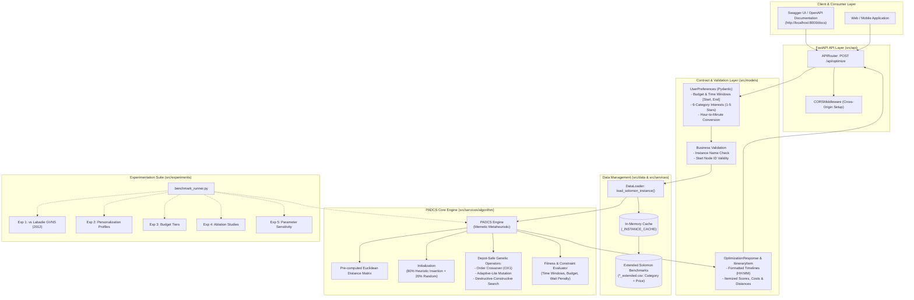

# PADCS: Personalized Adaptive Destructive-Constructive Search

<p align="center">
  
  
  
  
  
</p>

---

## 📌 Overview

**PADCS** (*Personalized Adaptive Destructive-Constructive Search*) is a hybrid Memetic Algorithm designed for solving the **Team Orienteering Problem with Time Windows (TOPTW)** with personalized multi-category scoring and realistic budget constraints.

Developed as a graduation thesis project at the **Faculty of Information Technology, VNU University of Engineering and Technology (VNU-UET)**, PADCS optimizes single-day travel itineraries by balancing:
- **Personalized Category Scores**: User interest ratings across 6 categories (History, Nature, Food, Shopping, Entertainment, Nightlife) with normalized weights.
- **Temporal Constraints**: Specific visit time windows $[O_i, C_i]$ per Point of Interest (POI) and hard return deadlines to the depot.
- **Budgetary Constraints**: Category-specific ticket and service prices derived from Hanoi tourism economic statistics.
- **Wait Time Penalization**: Idle waiting minimization to ensure seamless travel scheduling.

The system is packaged with a high-performance **FastAPI** backend and an extensive empirical evaluation suite.

---

## 🏗️ System Architecture

The following diagram illustrates the end-to-end architecture of PADCS, spanning client interfaces, API routing, contract validation, data caching, the core heuristic engine, and the benchmark testbed:



---

## 🧬 PADCS Algorithmic Lifecycle

PADCS combines global evolutionary exploration with aggressive **Destructive-Constructive Local Search** and a two-tier **Adaptive Mutation** mechanism:

```mermaid
flowchart TD
    Start(["Client Request / Benchmark Instance"]) --> InitPop["1. Population Initialization<br/>- 80% Randomized Insertion Heuristic (Labadie-based)<br/>- 20% Pure Random Permutation<br/>- Initial Smart Repair + Greedy Refill on each individual<br/>- Depot-Safe Encoding: [0, p1, p2, ..., pn, 0]"]

    InitPop --> GenLoop{"Generation Loop<br/>(gen < 200 AND<br/>stagnation < 25)?"}

    subgraph EvolutionCycle ["Evolutionary Optimization Cycle"]
        GenLoop -- "Yes" --> Telemetry["Generation Telemetry Analysis<br/>- Progress: gen / max_gen<br/>- Stagnation counter<br/>- Population diversity (unique routes ratio)<br/>- Rolling window insertion failure rate"]

        Telemetry --> AdaptiveMut["Adaptive-Lite Mutation Probabilities<br/>- Level 1 (Progress Schedule): Insert 45% -> 15%, 2-opt 25% -> 55%<br/>- Level 2 (Population Feedback):<br/>  * High stagnation (>=8): Boost 2-opt (+0.10)<br/>  * Low diversity (<35%): Boost Swap (+0.10)<br/>  * High insertion fail (>=60%): Reduce Insert (-0.10), Boost 2-opt"]

        AdaptiveMut --> Breeding["Breeding Offspring Population (Size = N)"]

        subgraph Reproduction ["Reproduction & Destructive-Constructive Local Search"]
            Breeding --> Tournament["Tournament Selection (k = 3)<br/>Select Parent 1 and Parent 2"]
            Tournament --> OX1["Depot-Safe Order Crossover (OX1)<br/>Operates strictly on interior route[1:-1]"]
            OX1 --> Mutate["Adaptive Mutation Execution<br/>Sample operator: 2-opt / Swap / Insertion"]
            Mutate --> SmartRepair["Smart Repair (Destructive Search)<br/>Remove POIs with lowest Score/Time ratio<br/>until time & budget constraints satisfied"]
            SmartRepair --> GreedyRefill["Greedy Refill (Constructive Search)<br/>Insert unvisited POIs with best marginal score/time"]
            GreedyRefill --> EvalChild["Evaluate Child Fitness & Feasibility"]
        end

        EvalChild --> MergedPool["Merge (Parents + Offspring) -> Pool Size 2N"]
        MergedPool --> ElitistSort["Sort Candidate Pool by Fitness Descending"]
        ElitistSort --> DiversityFilter["Diversity Filter & Replacement<br/>- Eliminate duplicate routes via POI set hashing<br/>- Inject Diverse Repaired Individuals if needed<br/>- Select top N unique individuals"]
        DiversityFilter --> UpdateBest["Update Best-Ever Individual<br/>- Fitness improved > threshold -> reset stagnation = 0<br/>- Else -> stagnation = stagnation + 1"]
        UpdateBest --> GenLoop
    end

    GenLoop -- "No (Convergence or Max Gen reached)" --> BestSolution["Extract Best Feasible Route<br/>- Format arrival, wait, service, leave times (HH:MM)<br/>- Calculate total score, cost, distance, execution time"]
    BestSolution --> End(["Return OptimizationResponse JSON"])
```



### Key Algorithmic Components

| Component | Technical Details |
|---|---|
| **Depot-Safe Encoding** | Routes strictly maintain `[Depot, POI_1, ..., POI_k, Depot]` structure. All operators target only `route[1:-1]`. |
| **Hybrid Initialization** | 80% initialized via insertion heuristic with randomized greedy criteria; 20% random shuffle for initial exploration. |
| **Order Crossover (OX1)** | Preserves relative interior order while preventing duplicate visits. |
| **Adaptive-Lite Mutation** | Two-tier dynamic probabilities balancing 2-opt, Swap, and Insertion based on generation progress, diversity, and failure rates. |
| **Destructive Search (Smart Repair)** | Sequentially prunes POIs yielding the lowest $\frac{\text{Score}}{\Delta\text{Time}}$ until all constraints (time windows, budget, return) are valid. |
| **Constructive Search (Greedy Refill)** | Re-inserts unvisited POIs greedily maximizing marginal score gain per unit time. |
| **Diversity Filter & Replacement** | $(\mu+\lambda)$ Merged Elitism with route hash duplicate rejection and automatic injection of diverse repaired individuals. |
| **Early Stopping** | Terminates automatically when the best fitness shows no significant improvement for 25 consecutive generations. |

---

## 📊 Empirical Benchmarks

The algorithm was thoroughly evaluated on the standard Solomon TOPTW benchmark instances (single-vehicle $m=1$), comparing against the state-of-the-art **GVNS** (Labadie et al., 2012) and **Best Known Solutions (BKS)** across 30 independent runs per instance.

### 1. Benchmark Comparison vs Labadie et al. (2012) GVNS

| Instance | BKS | GVNS Best | GVNS Avg | GVNS Gap% | PADCS Best | PADCS Avg | PADCS Std | PADCS Gap% | Avg Time (s) |
|:---|:---:|:---:|:---:|:---:|:---:|:---:|:---:|:---:|:---:|
| **C101** | 320 | 320 | 320.0 | 0.0% | **320.0** | 320.00 | 0.00 | **0.00%** | 7.09s |
| **C201** | 870 | 850 | 850.0 | 2.3% | **870.0** | 870.00 | 0.00 | **0.00%** | 38.05s |
| **R101** | 198 | 197 | 197.0 | 0.5% | **198.0** | 198.00 | 0.00 | **0.00%** | 6.41s |
| **R201** | 797 | 765 | 775.6 | 2.7% | **797.0** | 793.63 | 1.56 | **0.42%** | 68.51s |
| **RC101**| 219 | 219 | 219.0 | 0.0% | **219.0** | 219.00 | 0.00 | **0.00%** | 4.16s |
| **RC201**| 795 | 778 | 784.0 | 1.4% | **795.0** | 793.70 | 3.10 | **0.16%** | 46.88s |

> ⭐ **Key Result**: PADCS successfully discovered the **Best Known Solution (BKS)** on **100% (6/6)** benchmark instances, outperforming GVNS on C201, R101, R201, and RC201.

### 2. Ablation Study: Contribution of Destructive-Constructive Search

| Variant | Normalized Score (%) | Normalized Std | Avg Generations | Gap vs Full PADCS |
|:---|:---:|:---:|:---:|:---:|
| **Full PADCS (Smart Repair + Greedy Refill)** | **99.90%** | **0.28** | **37.3** | *Baseline* |
| **No Smart Repair (Simple tail-drop repair)** | 99.53% | 0.79 | 41.0 | -0.37% |
| **No Local Search (Repair & Refill disabled)** | 92.30% | 7.95 | 44.3 | **-7.60%** |

The ablation experiment clearly confirms that the hybrid Destructive-Constructive local search is vital for solution quality, improving normalized score by **+7.60%** over pure genetic operators.

---

## 🚀 Getting Started

### Prerequisites

- **Python 3.11+**
- Git

### Installation

```bash
# Clone the repository
git clone https://github.com/hm4uc/PADCS.git
cd PADCS

# Create and activate virtual environment
python -m venv .venv
# On Windows:
.venv\Scripts\activate
# On Linux/macOS:
# source .venv/bin/activate

# Install dependencies
pip install -r requirements.txt
```

### Running the API Server

```bash
cd src
uvicorn main:app --reload --host 0.0.0.0 --port 8000
```

- **API Base URL**: `http://localhost:8000`
- **Interactive Swagger Docs**: `http://localhost:8000/docs`
- **ReDoc UI**: `http://localhost:8000/redoc`

---

## 🧪 Reproducing Experiments

All experimental scripts are fully reproducible. On Windows, ensure UTF-8 console output is enabled:

```powershell
cd src
$env:PYTHONIOENCODING="utf-8"

# 1. Generate extended dataset (category classification + prices)
py -m experiments.generate_extended_data

# 2. Run Benchmark vs Labadie (2012)
py -m experiments.exp1_benchmark

# 3. Run Personalization impact across 5 tourist profiles
py -m experiments.exp2_personalization

# 4. Run Budget constraint evaluation across 3 tiers
py -m experiments.exp3_budget_impact

# 5. Run Ablation study on repair/refill operators
py -m experiments.exp4_ablation_repair

# 6. Run Parameter sensitivity experiments
py -m experiments.exp5_sensitivity

# 7. Aggregate results and generate publication charts
py -m experiments.analyze_results
py -m experiments.plot_charts
```

---

## 🔌 API Reference

### `POST /api/optimize`

Solves and returns the optimal itinerary for the given user preferences.

#### Request Example

```json
{
  "instance_name": "C101",
  "budget": 500000,
  "start_time": 8.0,
  "end_time": 17.0,
  "start_node_id": 0,
  "interests": {
    "history_culture": 5,
    "nature_parks": 3,
    "food_drink": 4,
    "shopping": 1,
    "entertainment": 2,
    "nightlife_wellness": 3
  }
}
```

#### Response Example

```json
{
  "total_score": 320.0,
  "total_cost": 380000.0,
  "total_distance": 68.45,
  "total_duration": 485.0,
  "execution_time": 0.42,
  "itinerary": [
    {
      "node_id": 0,
      "name": "Depot",
      "category": "depot",
      "arrival_time": "08:00",
      "wait_time": 0.0,
      "service_start": "08:00",
      "leave_time": "08:00",
      "score": 0.0,
      "cost": 0.0,
      "distance_from_prev": 0.0
    },
    {
      "node_id": 5,
      "name": "Temple of Literature",
      "category": "history_culture",
      "arrival_time": "08:25",
      "wait_time": 5.0,
      "service_start": "08:30",
      "leave_time": "09:30",
      "score": 100.0,
      "cost": 50000.0,
      "distance_from_prev": 8.5
    }
  ]
}
```

---

## 📁 Repository Structure

```
PADCS/
├── ARCHITECTURE_DOCUMENTATION.md   # Detailed Vietnamese technical architecture
├── LICENSE                         # MIT License
├── README.md                       # Main academic & technical documentation
├── requirements.txt                # Python package dependencies
├── references/                     # Academic literature & benchmark papers
└── src/
    ├── main.py                     # FastAPI application bootstrap & CORS
    ├── api/                        # Route definitions (/api/optimize)
    ├── core/                       # Global hyperparameters & penalties
    ├── data/                       # Solomon benchmark instances & extended CSVs
    ├── models/                     # Domain & Pydantic schemas (requests/responses)
    ├── services/
    │   ├── data_loader.py          # Cached instance loader
    │   └── algorithm/              # Core optimization engine
    │       ├── padcs_engine.py     # Main memetic evolution loop
    │       ├── initialization.py   # Randomized insertion heuristic & random init
    │       ├── fitness.py          # Feasibility check & multi-penalty fitness
    │       ├── response_builder.py # HH:MM timeline formatter
    │       └── operators/          # Depot-safe genetic & local search operators
    │           ├── crossover.py    # OX1 crossover
    │           ├── mutation.py     # 2-opt, Swap, Insertion mutation
    │           └── repair.py       # Smart Repair & Greedy Refill
    └── experiments/                # Scientific experimentation suite
        ├── benchmark_runner.py     # Batch execution framework
        ├── exp1_benchmark.py       # Labadie (2012) comparison
        ├── exp2_personalization.py # Interest profile evaluation
        ├── exp3_budget_impact.py   # Budget constraint evaluation
        ├── exp4_ablation_repair.py # Destructive-constructive ablation
        ├── exp5_sensitivity.py     # Parameter sensitivity analysis
        ├── analyze_results.py      # Statistical aggregation
        ├── plot_charts.py          # Publication-ready figures
        └── results/                # Empirical CSVs & chart artifacts
```

---

## 📜 Citation

If you use PADCS or reference this work in your research, please cite:

```bibtex
@mastersthesis{duc2026padcs,
  title     = {Personalized Adaptive Destructive-Constructive Search for the Team Orienteering Problem with Time Windows},
  author    = {Hoang Minh Duc},
  school    = {VNU University of Engineering and Technology},
  year      = {2026},
  address   = {Hanoi, Vietnam}
}
```

---

## 📄 License

This project is licensed under the MIT License - see the [LICENSE](LICENSE) file for details.

## 👤 Author

**Hoang Minh Duc**  
Faculty of Information Technology, VNU University of Engineering and Technology (VNU-UET)  
GitHub: [@hm4uc](https://github.com/hm4uc)
